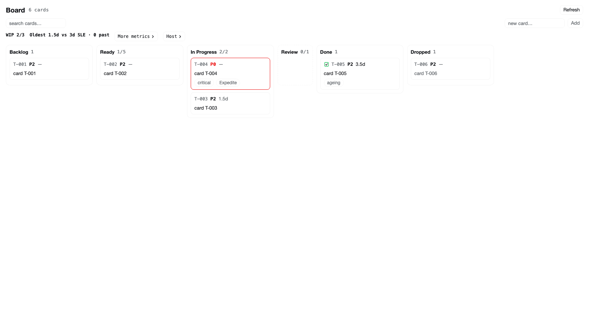
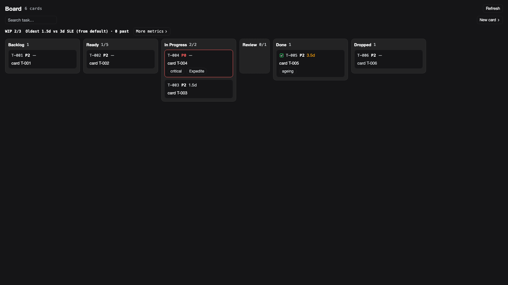
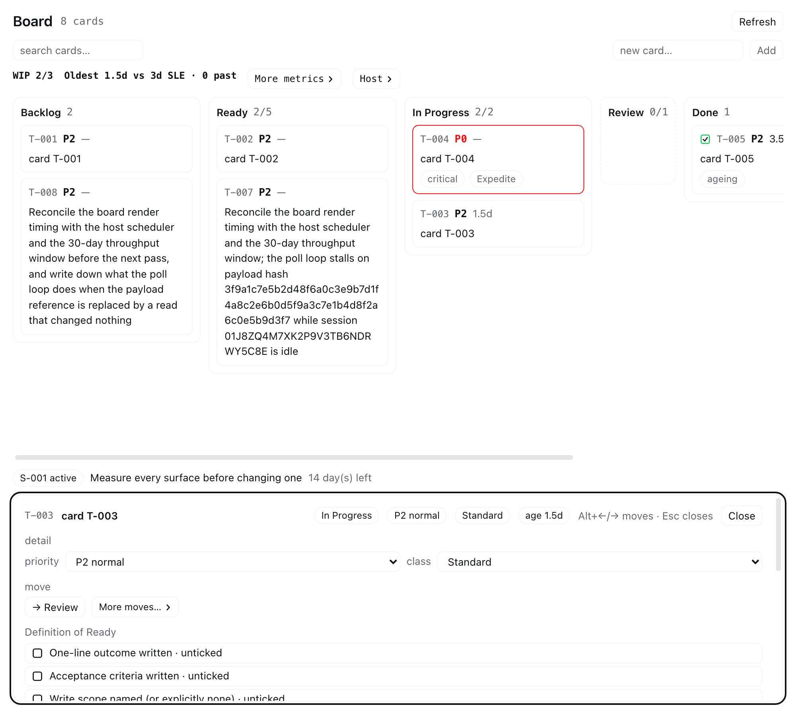
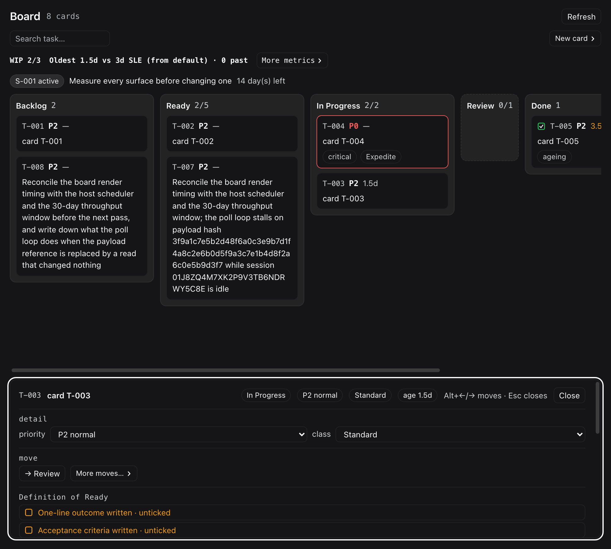
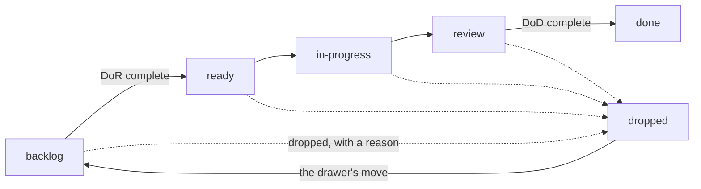

# dsh-kanban

One task board for the whole home directory, shared by Dhira and by every agent session: the panel is
the human's view, the `kanban_*` tools are the agents', and `bin/kanban.mjs` is the scripted one — all
over one SQLite store, through one policy engine, so **the gate that refuses an agent is the gate that
refuses the human**.

| surface | who uses it | what it does |
|---|---|---|
| **Kanban panel** (`sidebar.panellist` → `main`) | the human | every state as a lane (`dropped` last), drag-and-drop with a keyboard path, a search box, a `New card` button that opens a minimal create dialog, the card drawer with both checklists, the flow metrics and a collapsible history |
| **`kanban_*` tools** (9) and the `kanban` skill | agents | list, read, create, update/fill, move, drop, sprint, board, metrics — including the card's write scope |
| **`bin/kanban.mjs`** | the human, scripts, checks | the same verbs from a shell, with distinct exit codes |

## Why

Task state used to live in a hand-authored `$DSH_HOME/tasks/todo.md` and in whatever each session
remembered, and no surface could be trusted to agree with another: nothing enforced a gate, and
nothing recorded that a move had happened. The figures were the giveaway. An import stamped
`started_at = finished_at = now` on eleven migrated cards, and the generated view advertised

> Throughput 11 in 7 days · Cycle time median 0d · SLE … (history, from 11 finished)

while the event log held two moves. A board that asserts history it does not have is worse than no
board, because the number is read as evidence.

`dsh-kanban` replaces that with one SQLite store below all three surfaces and one policy engine above
it. The gates — Definition of Ready, Definition of Done, WIP limits, priority and class of service —
live in the store; every mutation appends an event; and `tasks/todo.md` became a **generated** view,
rewritten by every writer and checked for drift by `check-board.mjs`. The four flow metrics are
recomputed from what happened rather than read off a column.

## Agent Skills

The host half registers the **`kanban`** skill at runtime, so an agent session can work a card without
reading this source: list and read the board, create a card, refine it until the Definition of Ready
is ticked, move it through the gates, comment, block and unblock — and be refused with the names of
the items that are missing. The skill carries the DoR/DoD item names and the rule that a write scope
is data the agent must pass.

## Quick Start

The plugin lives inside the profile it serves, so "install" means *register it and restart the app*.
Either route ends the same way: a `link:` dependency, a bundle row, and a restart.

### Option A — the script

```bash
cd ~/.dsh/profiles/desktop/plugins/dsh-kanban
./install.sh            # registers the bundle in the profile and links it
./install.sh --check    # what would change
./install.sh --remove   # unregister
```

### Option B — by hand

1. **Clone it to a stable path** — the path becomes the install path.
   ```bash
   git clone https://github.com/mrdhira/dsh-kanban.git ~/.dsh/profiles/desktop/plugins/dsh-kanban
   ```
2. **`pnpm install`** — this plugin's own toolchain, not the profile's. Its `pnpm-workspace.yaml`
   allows esbuild's build script, which pnpm 11 blocks by default. The `prepare` script runs
   `node build.mjs`, which writes `lib/**` (the host half, the store and the client half) and
   `bin/kanban.mjs` — what `main` and the bundle point at.
3. **Register the dependency *and* the bundle name** in the profile's `package.json`
   (`~/.dsh/profiles/desktop/package.json`):
   ```json
   {
     "dependencies": { "dsh-kanban": "link:/absolute/path/to/dsh-kanban" },
     "dsh": { "profile": { "bundles": ["dsh-kanban"] } }
   }
   ```
4. **Install the profile link, then restart DSH** — `pnpm install` in the profile directory creates
   `node_modules/dsh-kanban`, the symlink the Loader resolves the package name through. A new bundle
   row is a composition change, so **a host-half change needs an app restart**. A client-half change
   needs only a page reload: the Loader picks up a new bundle row by itself, but a module inside a row
   that is already loaded does not reload (T-008).

### Configure

A fresh install needs **nothing**: the board defaults to `$DSH_HOME/tasks/board.db`, the generated
view to `$DSH_HOME/tasks/todo.md`, and the Definition of Workflow ships with the guide's limits. The
bundle row is created with an empty `config` on purpose — Cordis validates a row's config before the
plugin activates, and the host half exports no schema to validate against, so it reads every field
defensively and applies its own defaults.

| setting | default | effect |
|---|---|---|
| `dbPath` | `$DSH_HOME/tasks/board.db` | where the board's SQLite file lives |
| `mirror` | `true` | rewrite `tasks/todo.md` on every mutation |
| `pollMs` | `5000` | the panel's refresh interval while it is visible |

```yaml
- insert:
    - id: kanban
      name: dsh-kanban
      config:
        dbPath: /absolute/path/board.db
        mirror: true
        pollMs: 5000
```

A field the patch does not mention keeps the default above, so declare only what you mean to change.

## How it Works

Three surfaces read and write **one** store through **one** policy engine: a rule enforced in the
panel is enforced in the tools and the CLI, because there is only one implementation of it. The board
is `$DSH_HOME/tasks/board.db` (SQLite), and its history is the append-only `events` table — one row
per mutation. `$DSH_HOME/tasks/todo.md` is a **generated view** of that store; never hand-edit it.

A profile plugin **cannot import anything but Node builtins** (`@deepseek-ai/*` does not resolve from
a profile directory). That is why the DSH contracts are vendored in `src/types/dsh.ts`, the store is
our own SQLite, and the browser half talks to the host over this plugin's own HTTP route rather than a
typed Remote. `DESIGN.md` is the full design record and `PRODUCT.md` the product brief.

`/api/kanban` serves `health`, `board` (with `?since=<rev>` → `304`), `task/:id`, `export`, and
`POST mutate` with an op. The route is registered as a prefix on the app's own web server, so it wins
the longest-prefix match over the app's `/api` bridge and therefore **does not carry that bridge's
browser-session fence**: a request from this machine is believed, including an
`x-kanban-actor: human`. The server binds loopback only.

That is a deliberate, recorded trade for a single-user local tool. The boundary that matters — an
agent may not set a priority — is enforced at the *tool* boundary, where an agent's identity is its
session and not a header it can choose. A per-launch token is the obvious hardening and is deferred
until the index-injection question for a `file://`-loaded window is answered.

### What it looks like

The board, six lanes and every state reachable, in the app's own two themes. Nothing is styled against
the app: every colour is one of its theme tokens with a literal fallback.

| light | dark |
|---|---|
|  |  |

A card's drawer: one primary move, the rest behind a disclosure, the Definition of Ready as checkable
rows, and the history collapsed until asked for.

| light | dark |
|---|---|
|  |  |

### The flow

A card moves through five states, and two gates decide whether it may. `dropped` is off the workflow —
it is where a card goes when it leaves, and the way back is the drawer's own primary move.



- **Definition of Ready** — outcome, acceptance, write scope, estimate. A card in `backlog` cannot be
  pulled into `ready` until every item is ticked, and the refusal names the ones that are missing.
- **Definition of Done** — evidence, tests, docs, links, and no unverified claims, checked when a card
  enters `done`.
- **Work in progress** — `in-progress` and `review` carry their own limits. Only a human may set the
  limits, the priority or the class of service, and only `expedite` passes a limit that is otherwise
  full.
- **Dropping a card needs a written reason.** Dragging one onto `dropped` refuses the gesture and hands
  the move to the drawer, because that is the only place the reason can be typed.
- **Every move is an event**, so the flow metrics (cycle time, throughput, the service-level
  expectation) are computed from what happened rather than from what a column says.

### The rules the board enforces

They come from [The Kanban Guide (May 2025)](https://kanbanguides.org/the-kanban-guide/) for flow and
[the 2020 Scrum Guide](https://scrumguides.org/scrum-guide.html) for the optional timebox. Kanban has
no sprints, so this is Scrumban and the sprint layer is optional data. The full rationale is in
`~/.dsh/docs/kanban.md`.

- `backlog → ready → in-progress → review → done`, plus `dropped`; `blocked` is a flag, so blocked
  work still counts as WIP.
- **Definition of Ready** gates every exit from `backlog` except dropping.
- **A write scope is data, and agents should pass one.** `kanban_create` and `kanban_update` take
  `writeScope` — a workspace-relative file or directory prefix, or a list of them (the same shape the
  Agent Teams board's `write_scopes` carries). A recorded scope *is* the DoR's `write-scope` item, so
  the row reads as named and the card may leave `backlog`; a card with none is refused by name,
  because a gate that demands a fact no caller can supply is not a gate. The CLI takes the same fact
  as a repeatable `--write-scope` prefix, so a card created or edited from a shell is not gated on a
  field the shell cannot set; `--write-scope=` (an empty value) clears it on `update`, the same way an
  empty `--tags` clears the tags. A human may still tick the item for a scope recorded elsewhere (the
  pre-Kanban board, a task folder).
- **Definition of Done** gates `done`; work that does not meet it returns to the backlog.
- **WIP control**: `in-progress` 2, `review` 1, ready queue 5. `expedite` is the only exception.
- **Only the human** sets a priority or a class of service, and only the human may except a gate — and
  an exception must carry a written reason, which is recorded on the card.
- **The four flow metrics** (WIP, throughput, work item age, cycle time) and a **Service Level
  Expectation** derived from cycle time; the SLE says `guess` until ten items have finished.

### Trust and concurrency, stated precisely

Three claims are spelled out here rather than implied:

- **Optimistic concurrency is opt-in.** Every mutation accepts an `expectedRev` and refuses a write
  that carries a stale one; `bin/kanban.mjs`, the tools and the route only send it when the caller
  does, and the panel always does. A caller that omits it is choosing last-writer-wins. The mechanism
  is "a rev you supply is checked", not "no write can clobber another".
- **The CLI is the human's tool and trusts its shell.** `bin/kanban.mjs` defaults to `--actor human`,
  so an agent that shells out without `--actor agent:<session-id>` is recorded as Dhira and could set
  a priority or except a gate. There is no way to enforce otherwise from inside the process — an agent
  with a shell can lie. The gate that *is* enforced is on the agent's proper surface: a tool call
  carries its session and cannot claim to be the human.
- **`set-dow` is human-only and validated.** The Definition of Workflow is the control itself, so a
  malformed one is refused at the store rather than stored: a non-numeric WIP limit used to disable
  WIP control silently, and a `dor` that was not an array made every move throw. Fields the payload
  does not mention keep their stored value; a field that is present and wrong refuses the whole write.

### Requirements

**Build-time:** Node 22 or newer (the host half is emitted for `node22`, and the suite uses
`--test-isolation=none`), plus pnpm and the devDependencies — esbuild, TypeScript, React, jsdom. A
clone needs nothing but `pnpm install`.

**Run-time:** the DSH desktop app. The built `lib/**` needs no install step of its own and no
devDependencies; the store uses `node:sqlite`, which ships with the app's Node. `bin/kanban.mjs` is a
bundled ESM executable that imports nothing but Node builtins, so it runs from a clean checkout with
no `node_modules`.

### Development

```bash
pnpm install                      # one workspace, one lockfile; `prepare` builds lib/**
node scripts/gate.mjs             # build + typecheck + tests + freshness, ending in GATE PASS
node build.mjs                    # host + browser halves, the CLI, and the declarations
node scripts/typecheck.mjs        # three projects: host, browser, tests
npm test                          # builds first, then runs the suite under the guard
```

Run the gate rather than composing the steps by hand: it judges every step by **process exit code** and
prints one verdict, because twice this project read a broken build's `tail -1` as green — the guard
prints its own memory line last — and the suite then passed against a **stale bundle**. A build
failure invalidates every test result after it, so the gate builds first and checks freshness last.

**Build before you test.** The suite imports the generated `lib/**`, not `src/**`; `lib/` is
gitignored, so a fresh clone has none, and a test run against a stale build is green and wrong.

| source | built | what it is |
|---|---|---|
| `src/store/` | `lib/v1/store/**` | the board: schema, policy, metrics, the generated view, the import (no DSH import) |
| `src/host/` | `lib/v1/host/**` | the route, the nine tools, the skill, the probe record |
| `src/client/` | `lib/v1/client.js` | the panel: model, drag logic, transport, store, components, styles |
| `src/cli/` | `bin/kanban.mjs` | the CLI, bundled to a single executable |
| `types/` | — | the ambient build facts for each half |
| `test/` | — | table-driven suites against `lib/**` |

### Testing and Validations

Ten `test/*.test.ts` files, all against the built artifacts: the store and schema, the policy engine,
the four flow metrics, the generated view, the import of the pre-Kanban board, the CLI as a black box
(including its exit codes), the browser model and drag arithmetic, and the panel under jsdom against a
fake HTTP layer.

- **The freshness gate.** `scripts/gate.mjs` ends with `check-build-freshness.mjs`: artifacts must
  exist and must not predate their source. A stale `lib/**` invalidates every result above it.
- **Non-vacuity.** A new test is proven by mutation probe — break the code it names and watch it fail
  — not by passing. A test that cannot fail is not evidence.
- **Memory discipline.** Every `node` run goes through the vendored `scripts/guard.mjs`, which caps it
  (1 GB for the DOM suite, 512 MB for pure logic). Exit **124** means the cap was hit: bisect the run,
  never raise the cap. Two defects once took a machine to ~170 GB RSS.
- **Never assert on a DOM node.** Compare primitives — `assert.ok(node === null)`, not the node —
  because walking a failing React/jsdom node's fibers allocated gigabytes.
- **No test is skipped**, and a skipped one would have to say the exact condition that unskips it.
  (`test/migrate.test.ts`'s `skipped` list is data about the import, not a disabled case.)

### Contributing

One author: every commit here is authored and committed by **Dhira Wigata
<dwigata.putra@gmail.com>**, set repo-locally.

```bash
git config --local user.name  "Dhira Wigata"
git config --local user.email "dwigata.putra@gmail.com"
```

No `Co-authored-by`, no `Generated-by` or `Assisted-by`, no "Generated with …" byline — in the subject
or the body. Work an agent did is described in the commit body as prose ("Evidence: …").
`Signed-off-by` is fine. CI's `authorship` job checks the whole history for a single identity and for
any authorship trailer, so `--no-verify` does not reach it.

A change must pass the gate described in [AGENTS.md](AGENTS.md): `node scripts/gate.mjs` through the
guard, ending in `GATE PASS`. Issues and pull requests are welcome.

## LICENSE

MIT — see [LICENSE](LICENSE). Copyright (c) 2026 Dhira Wigata.
